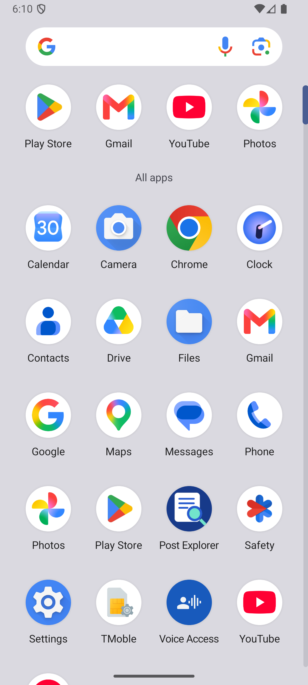
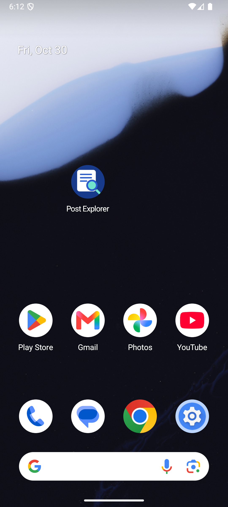
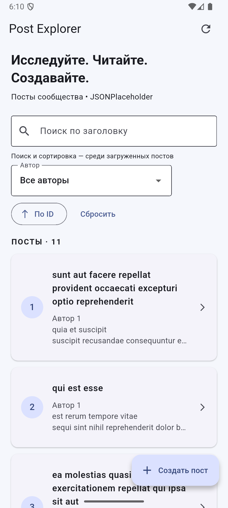

# Отчёт СРС 9

Дата выполнения: 30 октября 2026 года. Основа: Post Explorer из СРС 8, проект `srs8_post_explorer` репозитория RyumoN1337/flutter-projects-.

## Выполненные требования

| Требование | Результат |
| --- | --- |
| Собственная тематическая PNG-иконка | Карточка поста и лупа, 1024×1024, assets/icon/app_icon.png |
| flutter_launcher_icons | Подключён как dev-зависимость, настройки в pubspec.yaml, генерация успешна |
| Android / iOS | Сгенерированы необходимые ресурсы обеих платформ |
| Adaptive Icon | Отдельные фон и прозрачный передний слой, Android XML в mipmap-anydpi-v26 |
| Минимум 5 unit-тестов функции приложения | 13 новых тестов PostValidator, который используется реальной формой и репозиторием |
| Минимум 3 widget-теста реального экрана | 7 новых тестов реального PostExplorer |
| Некорректные входные данные | null, пустые строки, пробелы, неверная длина, отсутствующий/неположительный ID |
| Несколько элементов UI | Поля формы + выбор автора + отправка + отображение ответа |
| Переход между экранами | Лента → детали → лента; лента → форма → лента |
| Все тесты | 34 из 34 успешно, включая 14 сохранённых проверок СРС 8 |
| Анализатор | No issues found |
| Android APK | Debug-сборка успешна |
| Запуск | Установлено и запущено на emulator-5554, Android 16 API 36; /users и /posts ответили HTTP 200 |
| Визуальная проверка иконки | Новая круглая адаптивная иконка видна в списке приложений Android |

## Собственная иконка

Белая карточка обозначает публикации, лупа — поиск. Для адаптивной Android-иконки передний план имеет прозрачность; фон задан отдельно. Генератор применяет платформенные размеры. Название в Android-манифесте изменено на Post Explorer.

Скриншот снят с работающего Android-эмулятора через `flutter screenshot`. Иконка Post Explorer видна в четвёртом ряду общего списка, третья слева. Она не заменяет стандартный значок только внутри Flutter UI — это ресурс launcher установленного приложения.

## Запуск приложения

Приложение показывает посты с сервера, поиск, фильтр, сортировку и кнопку создания. На устройстве сохранился локальный пост предыдущей версии, поэтому на скриншоте счётчик равен 11: 10 серверных и 1 локальный. Данные пользователя при обновлении не очищались.

## Что проверяют тесты

`post_validator_test.dart`: 13 unit-тестов. Валидатор возвращает null для допустимого значения и сообщение для ошибки. Проверены обе границы title 5–100, body 10–1000, значения за границами, пробелы, null и ID автора. Общие правила исключают расхождение проверки в форме и перед сетевым запросом.

`post_screens_test.dart`: 7 widget-тестов. Тесты строят PostExplorer через pumpWidget, дожидаются обновления через pumpAndSettle, вводят текст через enterText и нажимают кнопки через tap. Assertions проверяют не только присутствие элементов, но и изменение видимого списка, порядок карточек, сообщения ошибок, отсутствие лишнего POST и навигацию.

Для проверки блокировки POST используется Completer: ответ намеренно удерживается, проверяется disabled-кнопка и число вызовов, затем ответ завершается и проверяется экран успеха. Во время ожидающего запроса используется pump(), а не pumpAndSettle(), поскольку анимированный индикатор не должен завершаться до ответа.

Экранные тесты используют контролируемый репозиторий и не зависят от интернета. Реальные Retrofit/Dio проверяются сохранёнными тестами СРС 8 с http_mock_adapter. Сами экраны и навигация в widget-тестах настоящие, демонстрационный счётчик из методички не используется.

## Подтверждение

- [Полный вывод тестов: All tests passed, +34](test-output.txt)
- [Анализатор](analyze.txt)
- [Генерация иконок](icon-generation.txt)
- [Android-сборка](android-build.txt)

Логи намеренно вызванных HTTP 500/503 и некорректного JSON в регрессионных тестах ожидаемы и не означают провал тестов. Предупреждение Gradle о restricted native access не помешало сборке.

## Ограничения проверки

Android установлен, запущен и визуально проверен. Ресурсы iOS сгенерированы, но запуск iOS на Windows не выполнялся (нужны macOS и Xcode). Web и Windows иконки обновлены генератором; повторная сборка этих платформ в рамках СРС 9 не выполнялась. Иконка проверена и в списке установленных приложений, и на домашнем экране эмулятора.

Ответы на 10 контрольных вопросов, команды запуска и текст для защиты находятся в основном README.

